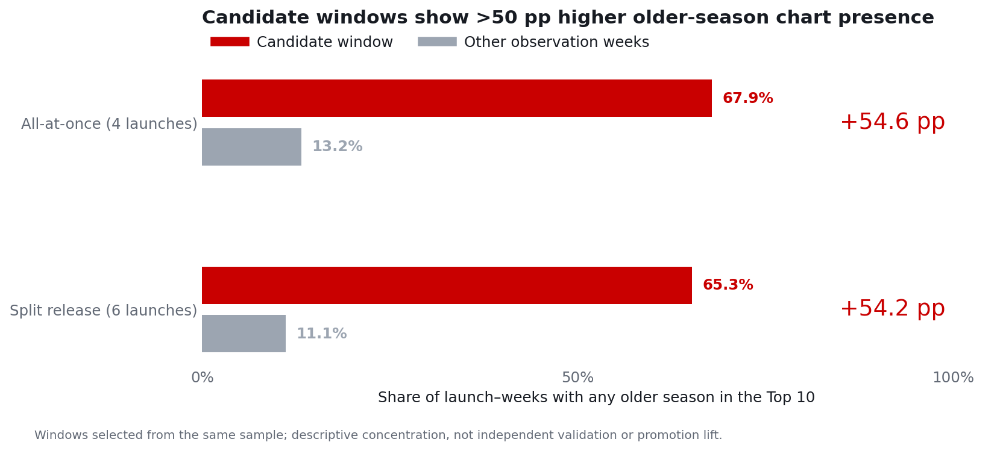

# Earlier-Season Promotion Around New-Season Releases

**When could Netflix promote earlier seasons around new-season releases to increase TV viewing hours?**

Python/pandas analysis of Netflix's Global Weekly Top 10, using 24-week launch-aligned datasets to identify candidate promotion periods, check series-specific patterns, and propose a measurable business experiment.

[Presentation PDF — 14 pages](presentation/netflix-promotion-analysis.pdf) · [Google Slides](https://docs.google.com/presentation/d/19YR-Ac5DwTtAb7lzRcB1JN2szpS2xcyNdwt8GMF3ADg/edit) · [Executed notebook](notebooks/netflix_analysis.ipynb) · [Runnable analysis](src/analyze.py) · [Methodology](docs/data_and_methodology.md)

## Executive answer

- **Start with candidate launch periods:** Weeks −1 to +5 for all-at-once releases and −1 to +10 for split releases. Older-season Top 10 presence is over 54 percentage points higher inside these periods than in the other observation weeks of the selected sample.
- **Tailor the approach:** Ms. Rachel shows a different timing pattern. The previous-versus-earlier-season comparison does not support a universal season-group priority.
- **Validate incremental impact:** propose added older-season promotion versus business as usual, measuring weekly TV viewing hours per randomized user before scaling.

The windows were chosen from the same chart patterns. These are descriptive opportunities for testing, not independently validated optimal periods or demonstrated promotion lift.



## Data preparation and analytical scope

The frozen snapshot contains **5,480 TV chart records across 274 reporting weeks**, from 4 July 2021 to 27 September 2026. The analysis follows **10 selected new-season launches across 6 series**, split into 4 all-at-once and 6 split releases.

Python/pandas standardizes season labels, aligns releases to Sunday-ending report weeks, checks complete category charts, and expands each older-season observation to Weeks −12 through +11. Validated joins retain off-chart observations instead of excluding seasons that never chart within a launch window.

| Counting unit | Meaning | Dataset size |
|---|---|---:|
| Distinct older season | A unique series and older-season number | 14 |
| Older season tracked at one launch | The same old season counts again at another launch | 21 |
| Older season × launch × week | The complete 24-week tracking panel | 504 |
| Launch × week | One yes/no result for any older-season listing | 240 |

**Coverage check:** all 21 older-season observations identified in the available season list are included; none are excluded. Bridgerton S2 around S4 remains included despite no Top 10 listings in any of the 24 weeks. The check cannot enumerate never-charted seasons outside the available list. Chart absence does not mean zero viewing.

## Timing comparison

| Release format | Candidate period | Any older season listed: inside | Other observation weeks | Difference |
|---|---|---:|---:|---:|
| All-at-once, 4 launches | −1 to +5 | 19/28 = 67.9% | 9/68 = 13.2% | +54.6 pp |
| Split release, 6 launches | −1 to +10 | 47/72 = 65.3% | 8/72 = 11.1% | +54.2 pp |

Each launch contributes one binary result per week; multiple listed older seasons still count once. These repeated weekly results do not increase the launch sample sizes beyond 4 and 6. Raw weekly counts contain different numbers of eligible older seasons and do not establish a release-format advantage.

Eight of ten launches have higher within-window presence; **Manifest S4 is tied**, while **Ms. Rachel S2 is lower** and has older-season listings mainly before its launch. Across the full snapshot, Ms. Rachel S1 appears in 26 of 75 first-to-last calendar weeks with a 38-week unlisted gap; this does not establish stable year-round viewing.

## Secondary question: which older seasons?

Use the same candidate periods, but compare the **mean per-season share of weeks listed**. Average earlier seasons within each launch, then give launches equal weight. This avoids favoring the earlier-season group just because it contains more seasons.

| Format | Previous season | Earlier seasons | Eligible launches |
|---|---:|---:|---:|
| All-at-once | 57.1% | 42.9% | 1: Squid Game S3 |
| Split release | 55.0% | 53.3% | 5 across 3 series |

Split-release differences average +1.7 pp: 3 positive, 1 tie and 1 negative. The small average does not establish equivalence; the all-at-once result is a single case. **Keep season selection exploratory.** [Paired launch details](docs/season_comparison.md).

## Proposed promotion experiment

Randomize eligible users within each format to additional older-season promotion or business as usual during the candidate period. Use **weekly TV viewing hours per randomized user** as the primary metric and total viewing hours as a substitution check. Set eligibility, sample size, duration and success thresholds using internal data before launch. No experiment was run in this project. [Experiment proposal](docs/experiment_proposal.md).

## Reproduce the analysis

Use Python 3.10 or later from the repository root:

```bash
python -m pip install -r requirements.txt
python src/analyze.py
python -m unittest discover -s tests -v
```

For interactive use:

```bash
python -m pip install -r requirements-notebook.txt
jupyter lab notebooks/netflix_analysis.ipynb
```

Run all notebook cells in order. The notebook and standalone script execute the same analysis steps and regenerate numeric CSV tables plus SVG/PNG figures. Shared [configuration](src/analysis_config.py) defines every window. Tests cover endpoint inclusion, complete/duplicate rows, all-zero observations, any-season counting and equal launch weighting. Results reconcile to the final presentation.

## Repository guide

| Location | Contents |
|---|---|
| `data/` | Unchanged chart snapshot and release references |
| `src/` | Reproducible data preparation, comparisons and figures |
| `notebooks/` | Executed analysis with findings and experiment proposal |
| `outputs/tables/` | Weekly panels, coverage audit, timing and season comparisons |
| `outputs/figures/` | Presentation-consistent charts in SVG and PNG |
| `presentation/` | Final 14-page PDF and executive-summary preview |
| `docs/` | Definitions, interpretation boundaries and test proposal |
| `tests/` | Analytical boundary and weighting checks |

## Limitations

- Selected sample: 10 launches across 6 series, with repeated series; it does not represent all multi-season Netflix shows.
- Top 10 data do not observe viewing below the chart threshold; available release references cannot establish complete season coverage or worldwide availability.
- Windows were selected from the same sample. Later batches and other events can affect listings; no causal release or promotion effect is established.
- Season comparisons include only 1 and 5 eligible launches. They do not establish a preferred season group or equivalence.
- Published charts span Netflix's historical switch from hours-based to views-based ranking. Release references are retained from the original project, not newly reverified.
- The public dataset has no user-level exposure, campaign cost or experimental data; no lift, retention or ROI claim is made.

The current project focuses on release-related promotion opportunities. Earlier TV/film and language-trend background pages have been removed to match the final presentation.
