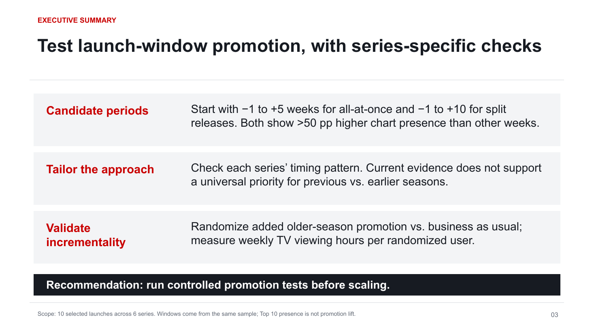

# Final presentation

[14-page PDF](netflix-promotion-analysis.pdf) · [Editable Google Slides](https://docs.google.com/presentation/d/19YR-Ac5DwTtAb7lzRcB1JN2szpS2xcyNdwt8GMF3ADg/edit)

The deck focuses on promotion opportunities around new-season releases. It puts the executive answer on page 3, merges the data introduction, and removes the earlier TV/film and language-trend background pages.

It includes the coverage check, candidate-window comparison, Ms. Rachel timing case, candidate-window season comparison and adjacent paired-launch support, interpretation limits and randomized-test proposal.

Export verified against the native deck on 9 November 2026 (America/Los_Angeles); native revision `fEg3zdNlol43bw`. The PDF has 14 pages. Windows: all-at-once −1 to +5; split release −1 to +10.

